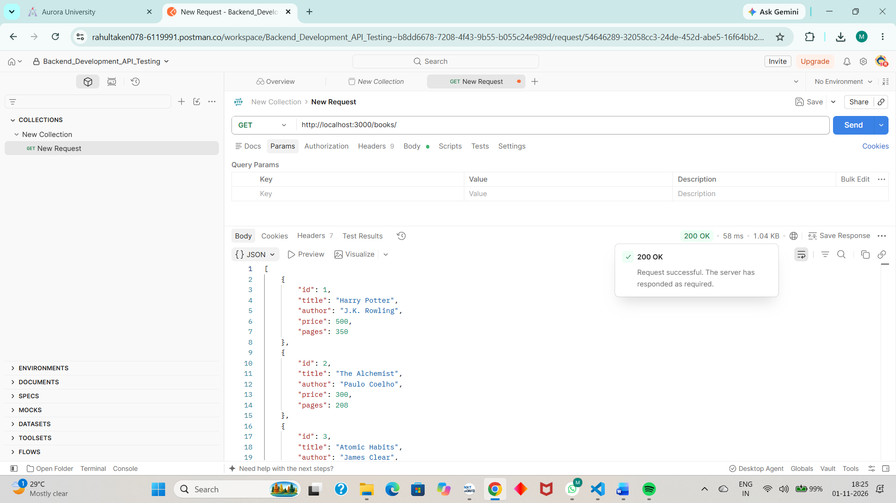
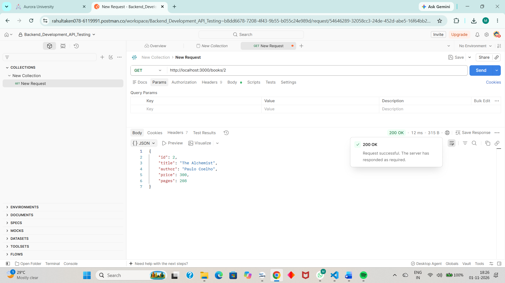
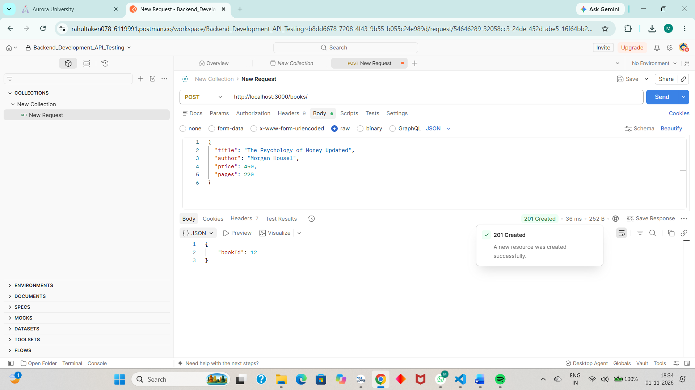
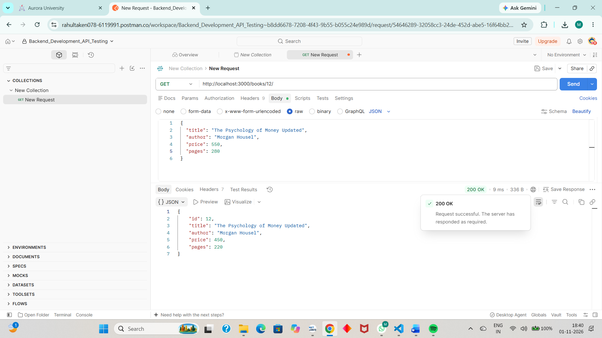
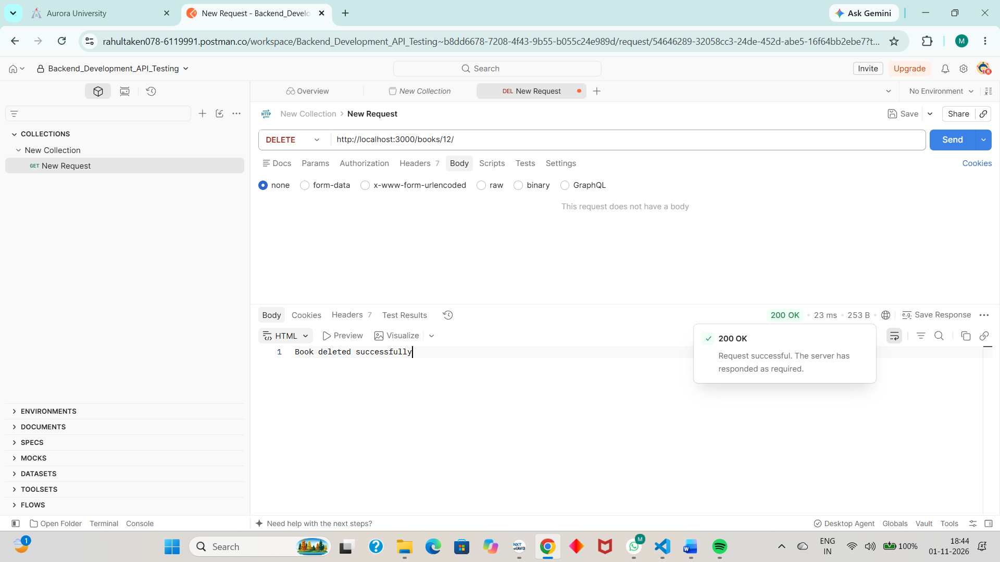

# Lab 02 – SQLite Database and CRUD Operations

## Student Details

- **Name:** Gurram Shravana Manikanta
- **Branch:** CSE (AIML)
- **Section:** 1B
- **Lab:** 02 – SQLite Database and CRUD Routes

## Live Deployment

- **Live API URL:** `https://your-render-service.onrender.com`
- **GitHub Repository:** `https://github.com/g-shravana-manikanta/Backend-Development-Labs`

> Replace the live API URL with your actual deployed Render URL after deployment.

## Aim

To develop a REST API using Node.js, Express.js, and SQLite to perform CRUD (Create, Read, Update, and Delete) operations on a Book database.

## Technologies Used

- Node.js
- Express.js
- SQLite
- sqlite3
- sqlite
- Nodemon
- Postman

## Project Structure

```text
lab-02/
│
├── index.js
├── bookstore.db
├── package.json
├── package-lock.json
├── .gitignore
├── README.md
│
└── screenshots/
    ├── get-all-books.png
    ├── get-book-by-id.png
    ├── post-book.png
    ├── put-book.png
    └── delete-book.png
```

## Database Structure

**Database Name:** bookstore.db

**Table Name:** book

| Column | Data Type | Description |
|---|---|---|
| id | INTEGER | Primary Key, Auto Increment |
| title | TEXT | Book title |
| author | TEXT | Book author |
| price | INTEGER | Book price |
| pages | INTEGER | Number of pages |

The database and table were created using the SQLite command-line interface. Initial book records were inserted using SQL INSERT statements.

## Installation

1. Clone the repository:

```bash
git clone https://github.com/g-shravana-manikanta/Backend-Development-Labs.git
```

2. Navigate to the Lab 02 directory:

```bash
cd Backend-Development-Labs/lab-02
```

3. Install dependencies:

```bash
npm install
```

## Running the Application

Start the development server:

```bash
npm run dev
```

The local server runs at:

```text
http://localhost:3000/
```

## API Endpoints

| Method | Endpoint | Description |
|---|---|---|
| GET | `/books/` | Retrieve all books |
| GET | `/books/:bookId/` | Retrieve a book by ID |
| POST | `/books/` | Add a new book |
| PUT | `/books/:bookId/` | Update a book |
| DELETE | `/books/:bookId/` | Delete a book |

### Sample POST Request Body

```json
{
  "title": "The Psychology of Money",
  "author": "Morgan Housel",
  "price": 450,
  "pages": 250
}
```

### Sample PUT Request Body

```json
{
  "title": "The Psychology of Money Updated",
  "author": "Morgan Housel",
  "price": 550,
  "pages": 280
}
```

## Implementation Details

- Used asynchronous database operations with `async` and `await`.
- Used `initializeDBAndServer()` to establish the database connection before starting the server.
- Used Express JSON middleware to process incoming JSON request bodies.
- Used parameterized SQL queries with `?` placeholders to prevent SQL injection.
- Used SQLite methods such as `db.all()`, `db.get()`, and `db.run()`.

## Screenshots – Postman API Testing

The following screenshots demonstrate the successful execution of all five CRUD operations.

### 1. GET – Retrieve All Books



### 2. GET – Retrieve Book by ID



### 3. POST – Add a New Book



### 4. PUT – Update a Book



### 5. DELETE – Delete a Book



## Database Verification

The database was verified using SQLite CLI to confirm that records were successfully inserted, retrieved, updated, and deleted.

## Conclusion

Successfully Connected an Express server to a SQLite database and expose CRUD operations over HTTP using Node.js, Express.js, and SQLite to perform all five CRUD operations on a Book database. Tested the API endpoints using Postman and verified database modifications using SQLite CLI.
