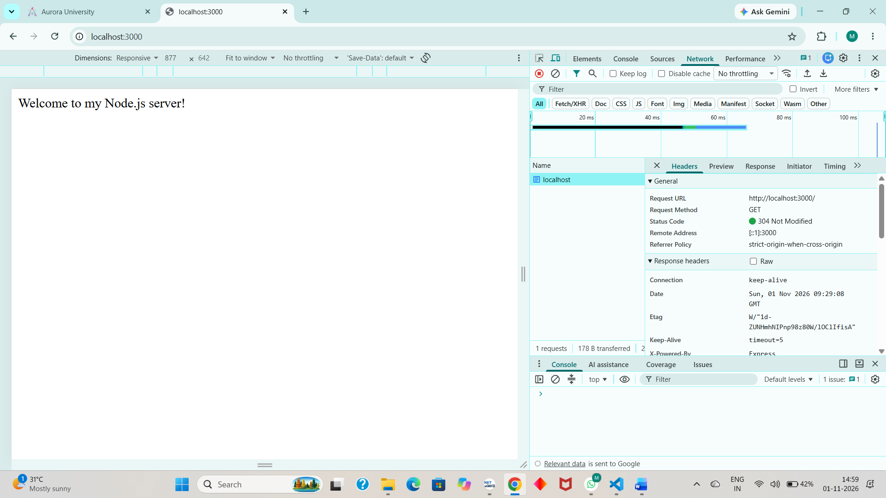
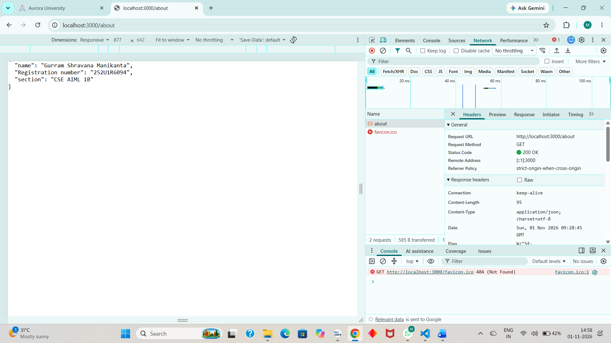
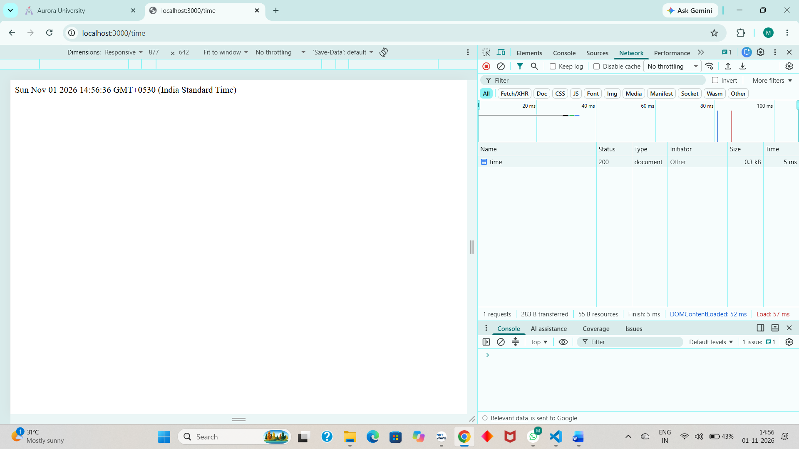
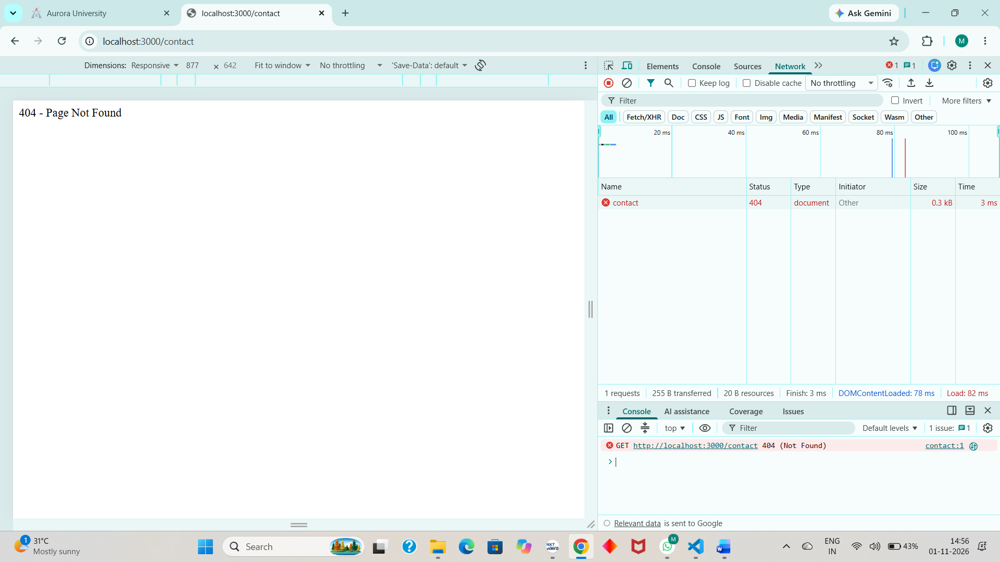

# Lab 1: Node.js and Express Server
**Name:** Gurram Shravana Manikanta  
**Registration Number:** 252U1R6094  
**Section:** CSE AIML 2B


## Live Link
Not deployed yet.

## Objective
To understand Node.js fundamentals and build a web server using the built-in HTTP module and Express.js.

## Technologies Used
- Node.js
- Express.js
- JavaScript

## Installation and Execution

1. Clone the repository.
2. Navigate to the Lab_1 folder.
3. Install dependencies:

```bash
npm install
```

4. Run the Express server:

```bash
node index.js
```

5. Open http://localhost:3000 in your browser.

## Endpoints

| Method | Endpoint | Description | Status |
|-----|----------|----------------------------------|-----|
| GET | /        | Welcome message                  | 200 |
| GET | /about   | Returns name and section in JSON | 200 |
| GET | /time    | Returns current date and time    | 200 |
| GET | /contact | Unknown route response           | 404 |

## Screenshots

### Home Route


### About Route


### Time Route


### 404 Error


## Notes
Implemented a basic HTTP server using Node.js and recreated it using Express.js. Learned routing, handling requests and responses, HTTP status codes, and 404 error handling.

## Problems Faced and Solutions
No Problems Faced.