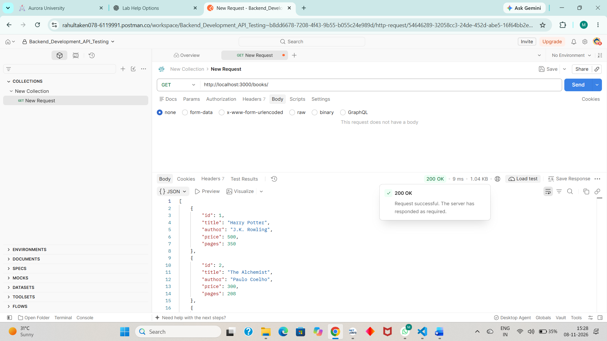
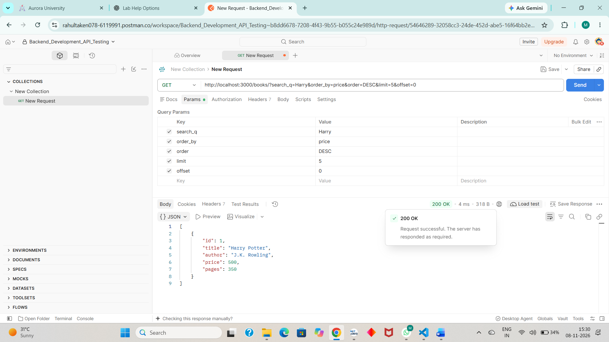
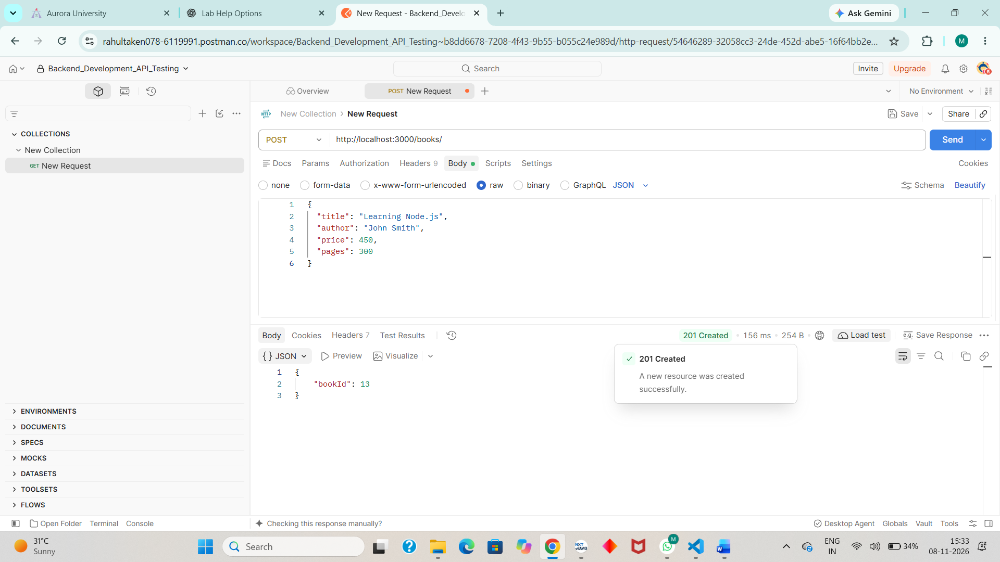
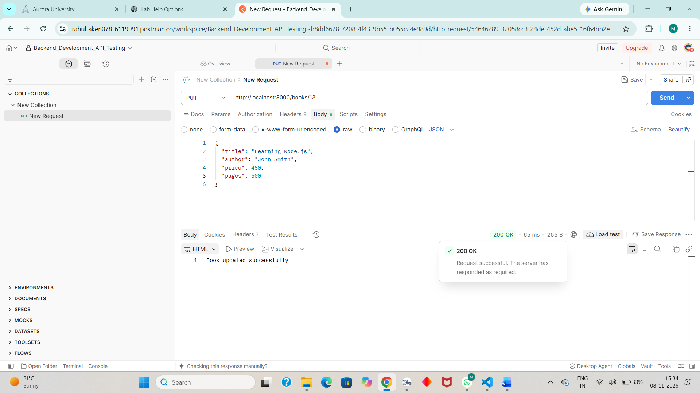
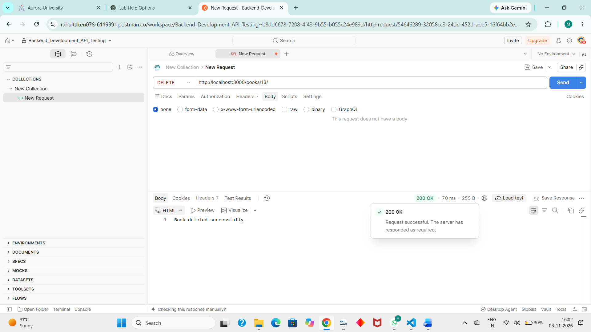

# Lab 3: REST API, Query Parameters, Validation, Debugging

## Student Details

- **Name:** Gurram Shravana Manikanta
- **Registration Number:** [Enter your registration number]
- **Section:** CSE AIML – 1B

## Live Link

[Enter your Render deployment URL]

If deployment is not completed, write: `Not applicable – Deployment not completed.`

## Project Description

This project demonstrates RESTful API development using Node.js, Express.js and SQLite.

The API supports CRUD operations for books, along with search, sorting, pagination, price-range filtering and request validation.

## How to Run

### Prerequisites

- Node.js
- npm
- SQLite

### Installation

1. Clone the repository.
2. Navigate to the project folder:

```bash
cd lab-03
```

3. Install dependencies:

```bash
npm install
```

4. Start the development server:

```bash
nodemon index.js
```

Alternatively, use:

```bash
npm start
```

### Environment Variables

| Variable | Description | Default |
|---|---|---|
| PORT | Server port | 3000 |

The SQLite database is stored in `bookstore.db`.

## API Endpoints

Base URL: `http://localhost:3000`

| HTTP Method | Endpoint | Description |
|---|---|---|
| GET | `/books/` | Get all books |
| GET | `/books/:bookId/` | Get a book by ID |
| POST | `/books/` | Add a new book |
| PUT | `/books/:bookId/` | Update a book |
| DELETE | `/books/:bookId/` | Delete a book |

### Query Parameters

The GET `/books/` endpoint supports:

| Parameter | Description |
|---|---|
| `search_q` | Search books by partial title |
| `order_by` | Sort using a column |
| `order` | Sort in ASC or DESC order |
| `limit` | Maximum number of records |
| `offset` | Number of records to skip |
| `min_price` | Minimum book price |
| `max_price` | Maximum book price |

Example:

```text
/books/?search_q=Harry&min_price=100&max_price=500&order_by=price&order=DESC&limit=5&offset=0
```

## Screenshots

Postman screenshots demonstrating the API operations and validation responses are stored in the `screenshots/` folder.

### GET All Books


### Search and Filtering


### Min-Max Price Range using Between


### POST Book


### PUT Book


### DELETE Book


## Notes: Problems Faced and Solutions

1. **Port Conflict (EADDRINUSE):** Occurs when the selected port is already being used by another process. Resolved by stopping the existing server or using another port.
2. **Incorrect Import Path:** Checked the module path and corrected the import statement.
3. **SQLite Table Error:** Corrected the table name in SQL queries to match the database schema.
4. **Missing Await:** Used `await` with asynchronous database operations to ensure results are received before sending responses.
5. **SQL Query Parameters:** Used parameterized queries to safely pass user-provided values into SQL statements.

## Technologies Used

- Node.js
- Express.js
- SQLite
- JavaScript
- Postman
- Git and GitHub