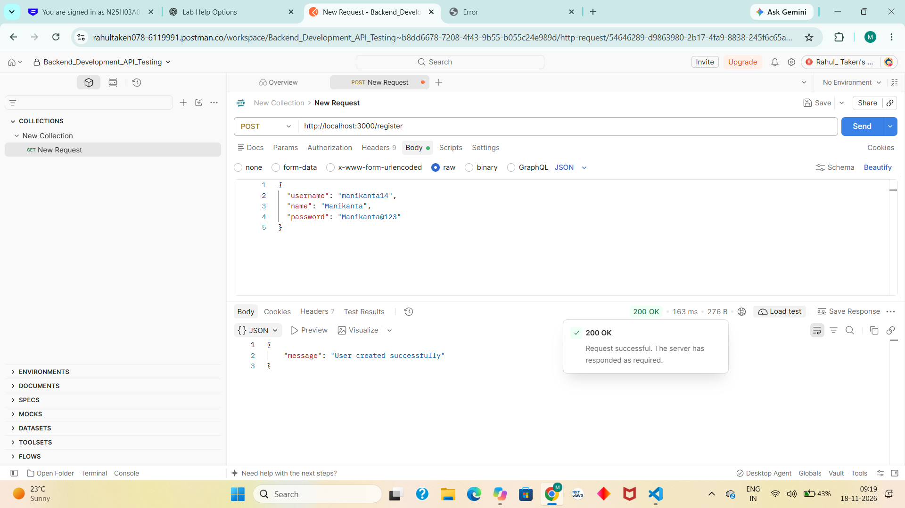
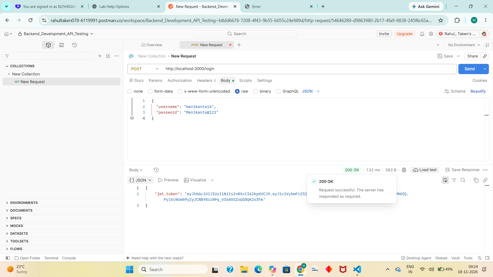
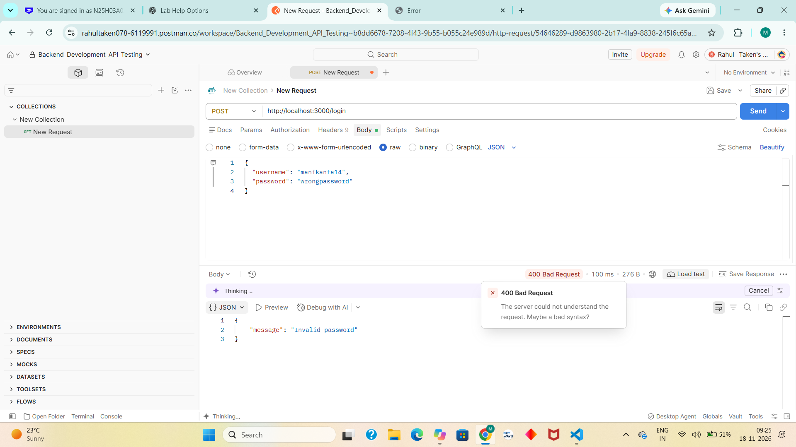
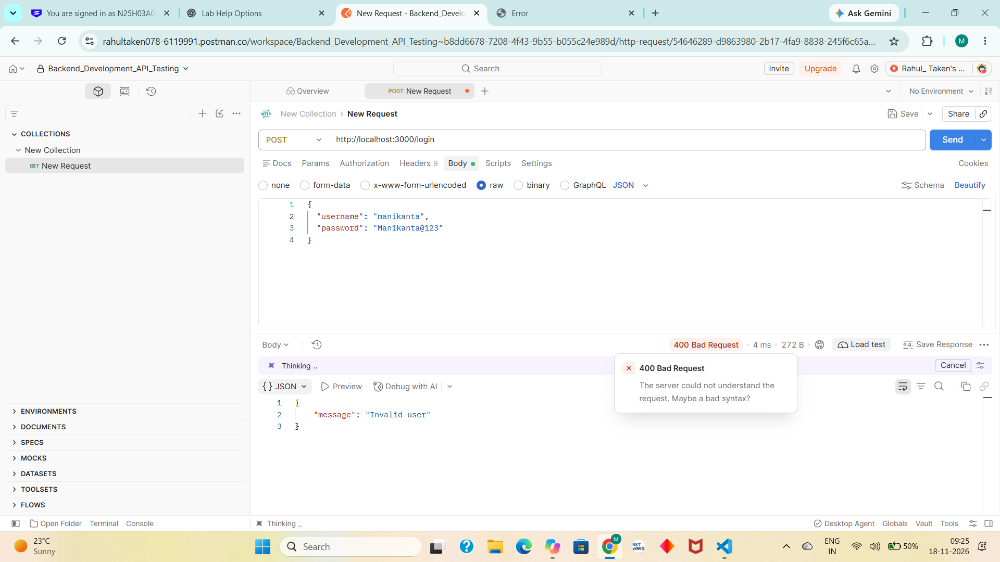
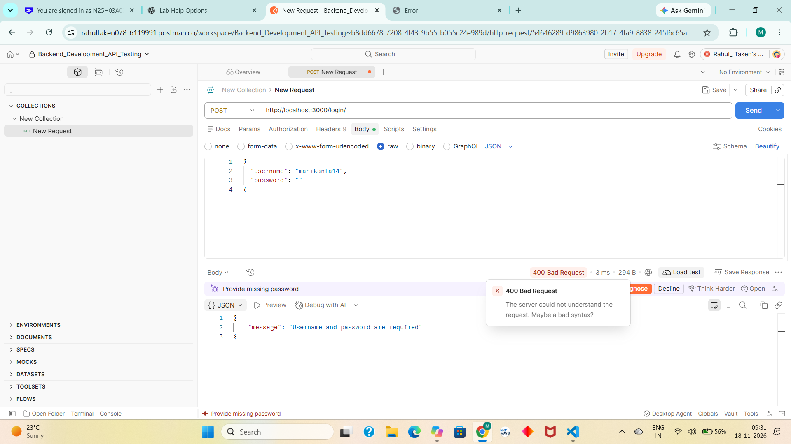
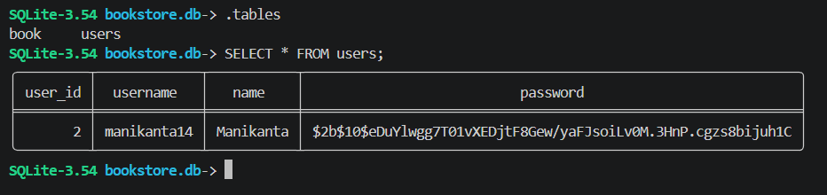
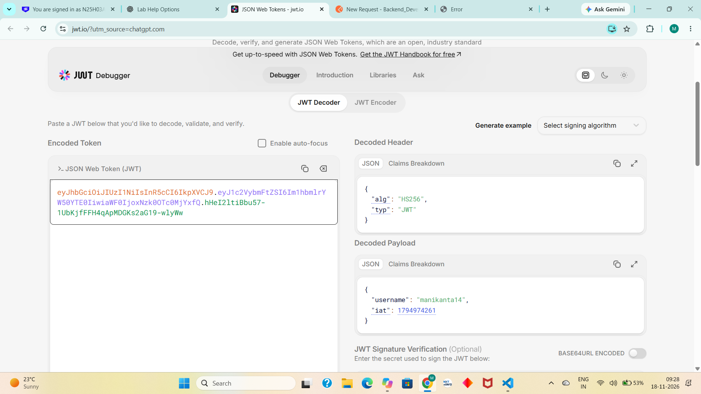

# Lab 4: Registration, Login and JWT

## Student Details

- **Name:** Gurram Shravana Manikanta
- **Registration Number:** 252U1R6094
- **Section:** CSE AIML – 2B

## Live Link

 **Live API URL:** https://backend-development-lab-04.onrender.com

## Project Description

This project implements user registration and login functionality using Node.js, Express.js, SQLite, bcrypt and JSON Web Tokens (JWT).

The application allows users to register with a unique username, name and password. Passwords are hashed using bcrypt before being stored in the SQLite database.

During login, the application verifies the submitted password using `bcrypt.compare()`. If the credentials are correct, a JWT is generated using `jwt.sign()` and returned to the user.

## Technologies Used

- Node.js
- Express.js
- SQLite
- JavaScript
- bcrypt
- jsonwebtoken
- Postman
- Git and GitHub

## How to Run

### Prerequisites

- Node.js installed
- npm installed
- SQLite database

### Installation

1. Clone the repository:

```bash
git clone https://github.com/g-shravana-manikanta/Backend-Development-Labs.git
```

2. Navigate to the Lab 04 folder:

```bash
cd Backend-Development-Labs/lab-04
```

3. Install dependencies:

```bash
npm install
```

4. Start the development server:

```bash
nodemon index.js
```

Alternatively, run:

```bash
npm start
```

The server will start at:

```text
http://localhost:3000/
```

### Dependencies

The project uses the following npm packages:

- `express` – Handles HTTP requests and API routes.
- `sqlite` – Provides an asynchronous interface for SQLite.
- `sqlite3` – SQLite database driver.
- `bcrypt` – Hashes and verifies passwords.
- `jsonwebtoken` – Generates JSON Web Tokens.
- `path` – Handles file paths.

### Environment Variables

| Variable | Description | Default |
| -------- | ----------- | ------- |
| PORT     | Server port | 3000    |

The JWT secret key is currently defined as a constant in `index.js`, as specified in the Lab 04 assignment. It should be moved to an environment variable in later labs.

The SQLite database is stored in `bookstore.db`.

## API Endpoints

Base URL:

```text
http://localhost:3000
```

### Authentication Endpoints

| HTTP Method | Endpoint     | Description                              |
| ----------- | ------------ | ---------------------------------------- |
| POST        | `/register/` | Registers a new user                     |
| POST        | `/login/`    | Authenticates a user and generates a JWT |

### Book Endpoints

| HTTP Method | Endpoint          | Description                                                        |
| ----------- | ----------------- | ------------------------------------------------------------------ |
| GET         | `/books/`         | Retrieves all books with search, sorting, filtering and pagination |
| GET         | `/books/:bookId/` | Retrieves a book using its ID                                      |
| POST        | `/books/`         | Adds a new book                                                    |
| PUT         | `/books/:bookId/` | Updates an existing book                                           |
| DELETE      | `/books/:bookId/` | Deletes a book                                                     |

## Authentication Implementation

### 1. User Registration

The registration endpoint accepts a username, name and password.

Before creating a user, the application checks whether the username already exists.

The password is hashed using:

```javascript
bcrypt.hash(password, 10);
```

Only the hashed password is stored in the database.

### 2. User Login

The login endpoint checks whether the username exists in the database.

The submitted password is compared with the stored password hash using:

```javascript
bcrypt.compare(password, dbUser.password);
```

If the credentials are correct, the application generates a JWT.

### 3. JWT Generation

The JWT is generated using:

```javascript
jwt.sign(payload, jwtSecret);
```

The payload contains only the username.

A JSON Web Token consists of three parts:

- Header – Contains token type and signing algorithm.
- Payload – Contains the username.
- Signature – Verifies the token's integrity.

The generated token can be decoded using [JWT.io](https://jwt.io/).

## Postman Testing

The following test cases are used to verify the authentication APIs.

| Test Case                        | Expected Result |
| -------------------------------- | --------------- |
| Register a new user              | 200 OK          |
| Register an existing username    | 400 Bad Request |
| Login with correct credentials   | 200 OK with JWT |
| Login with unknown username      | 400 Bad Request |
| Login with incorrect password    | 400 Bad Request |
| Register without required fields | 400 Bad Request |

### Sample Registration Request

**POST** `/register/`

```json
{
  "username": "manikanta14",
  "name": "Manikanta",
  "password": "Manikanta@123"
}
```

### Sample Login Request

**POST** `/login/`

```json
{
  "username": "manikanta14",
  "password": "Manikanta@123"
}
```

### Sample Successful Login Response

```json
{
  "jwt_token": "generated_jwt_token"
}
```

## Screenshots

The Postman screenshots demonstrating successful and unsuccessful registration and login operations are stored in the `screenshots/` folder.

### 1. User Registration – Successful


### 2. User Registration – Existing Username
1[User Registration – Existing Username](screenshots/user-registration-existing-username.png)

### 3. User Login – Successful


### 4. User Login – Incorrect Password


### 5. User Login – Unknown Username


### 6. Login – Required Fields Validation


### 7. Database – Stored Password Hash


### 8. JWT Token Decoding


## Notes: Problems Faced and Solutions

1. **SQLite Column Error:** Encountered a SQL error when the username was interpreted as a column name. Resolved it by using parameterized SQL queries with placeholders.

2. **JWT Not Defined:** Encountered `jwt is not defined` during login. Resolved it by importing the `jsonwebtoken` package using `require("jsonwebtoken")`.

3. **Password Security:** Implemented bcrypt hashing to ensure that original passwords are never stored in plain text.

4. **Duplicate User Registration:** Used a database query to check whether a username already exists before inserting a new user.

5. **Asynchronous Operations:** Used `async/await` with database operations, password hashing and password comparison to ensure operations complete before sending responses.

## Conclusion

This lab demonstrates the implementation of user registration and login using password hashing and JSON Web Token authentication.

Passwords are stored securely as bcrypt hashes, and successful login generates a JWT containing the username. The application also handles duplicate usernames and invalid login credentials through appropriate HTTP status codes.

The project provides practical experience with authentication, database operations, password security and JWT generation using Node.js and Express.js.
